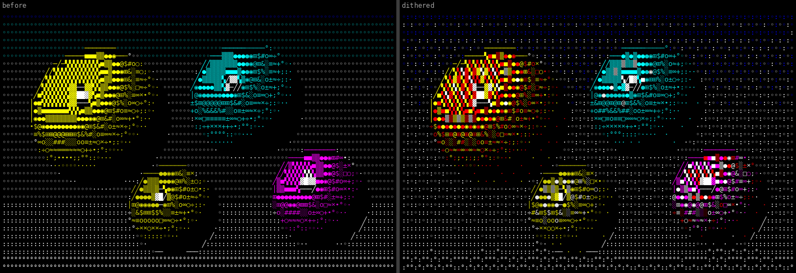
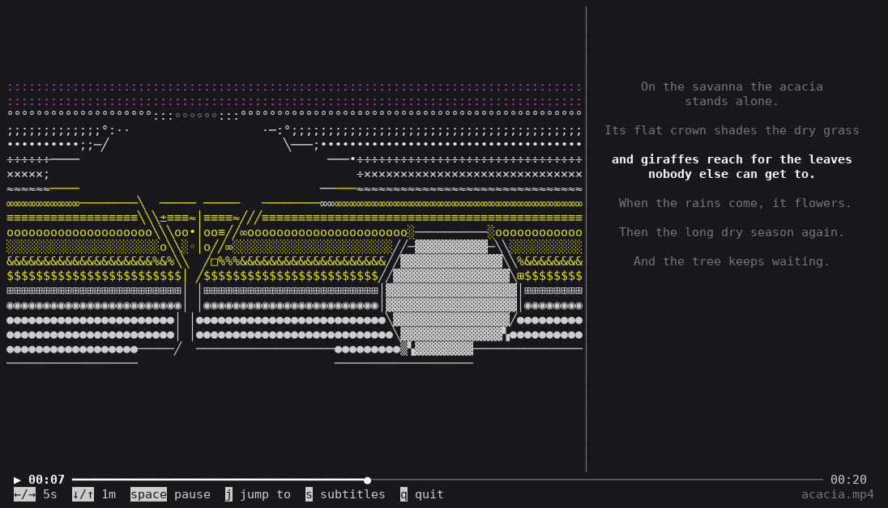

# ASCacia

Turn images and videos into colored ASCII or Unicode art and view them right in the
terminal, locally or over SSH.

## Install

```sh
uv tool install git+https://github.com/Templarrr/ascacia
```

Video support needs [PyAV](https://pyav.basswood-io.com/) (it ships its own FFmpeg) and is
optional; add the `video` extra to get it:

```sh
uv tool install "ascacia[video] @ git+https://github.com/Templarrr/ascacia"
```

## Usage

```sh
ascacia_image photo.jpg                     # full-screen viewer, q or Esc to quit
ascacia_image photo.jpg --charset unicode   # block and box-drawing symbols
ascacia_image photo.jpg --print --cols 100  # write the art to stdout instead
ascacia_image photo.jpg --no-dither         # flat bands instead of mixed shades
ascacia_image --help
```

The picture is fitted to the terminal keeping its proportions and is refitted when the
window is resized. Contours are drawn with line symbols (`- / | \` or `─ ╱ │ ╲`), the rest
with a density ramp, colored with the standard 16 (or 8) terminal colors.

Pictures are dithered: the rounding error of every symbol and color is spread over the
cells next to it (Floyd-Steinberg), so smooth gradients come out as a mix of neighbouring
symbols instead of flat bands, and hues the palette lacks are mixed from the ones around
them, e.g. red and yellow for orange or magenta and white for pink.



### Video

```sh
ascacia_video movie.mp4                         # subtitles next to it are picked up
ascacia_video movie.mp4 --subtitles other.vtt  # or given explicitly
ascacia_video movie.mkv --list-subtitles       # tracks inside the video
ascacia_video movie.mkv --subtitle-track fre   # pick one by number or language
ascacia_video movie.mp4 --start 12:30 --charset unicode
ascacia_video movie.mp4 --dither               # off by default, the pattern crawls
```



The frame takes the main part of the screen, the subtitles run beside it like song lyrics
(the current lines bright, the ones around them gray) and the timeline and keys sit at the
bottom. Subtitles come from, in order: `--subtitles`, an `.srt` or `.vtt` file named like
the video (`movie.srt`, `movie.en.srt` and so on), or the first text track inside the video
(SRT, ASS/SSA, WebVTT, MP4 timed text). Picture-based tracks (Blu-ray PGS, DVD VobSub) are
skipped. There is no sound.

| Key | Action |
| --- | --- |
| `←` / `→` | back / forward 5 seconds |
| `↓` / `↑` | back / forward 1 minute |
| `space` | pause / resume |
| `j` | jump to a time (`1:02:03`, `12:30` or `90`) |
| `s` | show / hide subtitles |
| `q`, `Esc` | quit |

Frames that can't be converted in time are skipped, so playback keeps pace with the clock
on slow machines or big terminals.

## As a library

```python
from ascacia import UNICODE, fit_size, image_to_cells, load_image, render_ansi

image = load_image("photo.jpg")
cols, rows = fit_size(image.width, image.height, max_cols=120, max_rows=40)
# rows of Cell(char, color); dither=True mixes in-between shades and hues
cells = image_to_cells(image, cols, rows, charset=UNICODE, dither=True)
print(render_ansi(cells))

# with the video extra
from ascacia import Video, load_subtitles, play_video

with Video("movie.mp4") as video:
    for frame in video.frames(start=60):
        cells = image_to_cells(frame.to_image(320, 120), 80, 30)
    play_video(video, load_subtitles("movie.srt"))

with Video("movie.mkv") as video:
    track = video.find_subtitle_track("eng")  # or a number, or None for the first text track
    play_video(video, video.read_subtitles(track))
```

## Development

```sh
uv sync
uv run pytest
uv run ruff check . && uv run ruff format --check .
```
